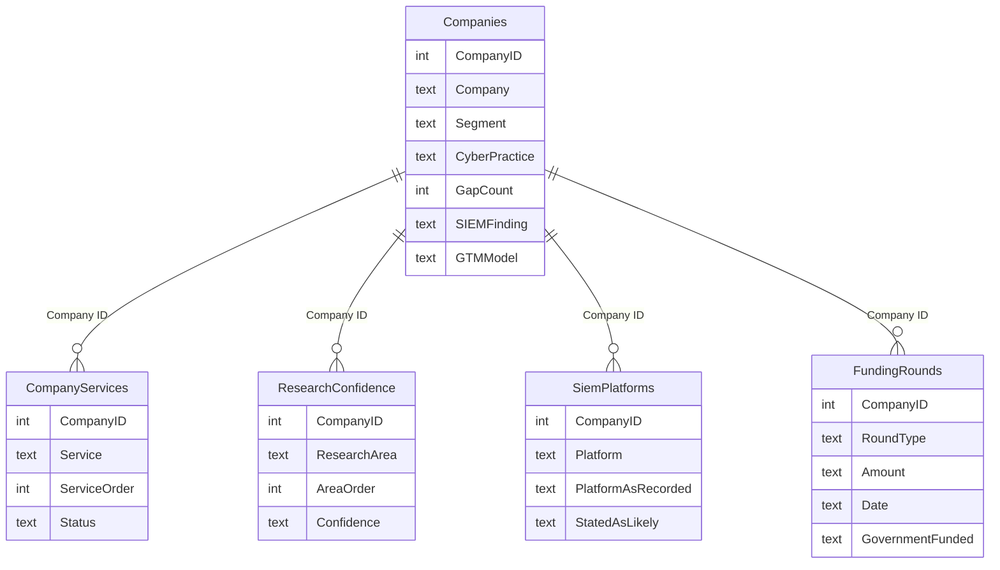

# Malaysia Partner Intelligence

A Power BI project built on research into **193 IT and cybersecurity firms operating in Malaysia**, assessed as
potential channel partners. Each firm was segmented, checked against 9 managed-security services, mapped to the SIEM
platform it uses or resells, profiled for funding and ownership, and classified by go-to-market model. Every finding
carries a confidence rating and an evidence link.

The research tables are modelled as a star schema (Power Query unpivots and lookups), with **32 DAX measures** and
**7 report pages**.

**Built with:** Power BI (Power Query M, DAX, PBIP / TMDL + PBIR), Python for data preparation.

---

## The research data

The starting list came from a company-database export of ASEAN cybersecurity firms:
- firms headquartered in Malaysia;
- firms headquartered elsewhere in ASEAN that showed real Malaysian operations: a registered entity, an office,
  local staff or named local customers. A QA pass re-checked every positive verdict.

| HQ country | Firms |
|---|---|
| Malaysia | 146 |
| Singapore | 42 |
| Thailand, Philippines, Indonesia, Vietnam | 5 |

The research ran in modules. Each module wrote its own workbook, and the workbooks were then joined into one master
table:

- **Segmentation:** the primary segment in the firm's own words, then a normalisation pass into 14 segment groups.
  Also recorded: a hybrid flag (two or more different business models), whether the firm has a cybersecurity
  practice (Yes / Partial / No), market focus, geographic focus and MSC Malaysia status.
- **Services gap:** firms with no cyber practice in a non-cyber segment were skipped first and marked N/A. Every
  other firm got Yes / No / Unverified for 9 services: Digital Forensics, Incident Response, DFIR, MDR/EDR, XDR, SIEM, VA/Pen Test,
  SOC-as-a-Service and Compromise Assessment. The **gap count** is the number of "No" answers. Two review flags
  were added:
  - **Conflict flag:** segmentation said "no cyber practice", but services were found.
  - **Segmentation override:** the services research overruled the segment verdict.
- **SIEM platform:** five evidence layers were tried for every firm before it could be logged as "Unverified":
  1. the firm's website;
  2. job postings;
  3. employee certifications;
  4. vendor partner directories;
  5. press and news.

  Each confirmed platform also records:
  - its **relationship type**: reseller, certified practice, powered-by, internal deployment, OEM or technology
    partner;
  - the **signal source**: which layer confirmed it.

  Confidence follows fixed rules. For example, a job posting that names the platform is Medium, and a vendor
  directory listing is High.
- **Funding and ownership:** ownership type, funding status, disclosed rounds, stock-exchange listing and
  government-linked (GLC) status. "Not publicly disclosed" was always preferred to an estimate.
- **Go-to-market:** each firm was classified as Direct, Partner-led, Hybrid or Unknown, with cited partner-side and
  direct-side evidence. Three rules applied:
  - Reselling another vendor's product is sourcing, not a partner-led motion.
  - A direct-looking website is not proof of a direct model.
  - With no positive evidence either way, the firm stays **Unknown**.

  The 115 firms in the nine core segments (MSSP, MDR, consultancies, systems integrators, MSPs with a security
  practice, telcos, pen-testing, IR/forensics and SaaS security) form the **GTM shortlist**, the focus of the
  go-to-market summary.
- **Quality control:** every module rates each finding High / Medium / Low, keeps an evidence URL and records
  whether the source page could be fetched.

| Dataset | Rows | What it holds |
|---|---|---|
| Companies | 193 | profile, segment, 9 services + gap count, SIEM finding, funding / ownership, GTM model, 5 confidence ratings, evidence links and notes |
| SIEM platform links | 47 | one row per firm and platform (37 firms, 19 platforms), name as recorded + platform family |
| Funding rounds | 19 | disclosed rounds for 15 firms: type, amount as disclosed, date, government-funded flag, source |

## Results

**Segments** (normalised groups):

| Segment | Firms | | Segment | Firms |
|---|---|---|---|---|
| System Integrator | 31 | | Other / Non-Cyber | 9 |
| MSSP / MDR | 29 | | Specialist Security Firm | 8 |
| MSP / Cloud MSP | 25 | | Diversified Technology Group | 8 |
| Consultancy | 22 | | Telco / Telco ICT | 3 |
| VAR / Distributor | 21 | | GLC ICT | 3 |
| Vendor / ISV | 17 | | Unverified | 2 |
| Software Development / IT Services | 14 | | Security Awareness & Training | 1 |

Cybersecurity practice: **Yes 79**, Partial 91, No 23.

**Services gap** (181 firms researched, 12 skipped as non-cyber):

| Service | Firms offering | | Missing services | Firms |
|---|---|---|---|---|
| VA / Pen Test | 52 | | 0–3 (strong portfolio) | 10 |
| Incident Response | 36 | | 4–6 (mid) | 22 |
| MDR / EDR | 28 | | 7–9 (narrow / minimal) | 136 |
| SOC-as-a-Service | 27 | | Not verified | 13 |
| Digital Forensics | 18 | | Not assessed (non-cyber) | 12 |
| SIEM | 13 | | | |
| DFIR | 12 | | | |
| Compromise Assessment | 10 | | | |
| XDR | 5 | | | |

101 firms offer none of the 9 services.

**SIEM platform:** 37 firms confirmed, 123 none identified, 33 unverified after all layers. The most common platforms
are Splunk (7 firms), Microsoft Sentinel (7), LogRhythm (6), IBM QRadar (3) and Wazuh (3); 7 firms work with more
than one. Among the 37 confirmed firms, the relationships are:

| Relationship | Firms |
|---|---|
| Reseller | 16 |
| Certified practice | 8 |
| Powered-by | 5 |
| Internal deployment | 4 |
| OEM | 2 |
| Technology partner | 2 |

**Go-to-market:**

| GTM model | All firms | GTM shortlist |
|---|---|---|
| Direct | 74 | 52 |
| Hybrid | 41 | 28 |
| Partner-led | 31 | 8 |
| Unknown | 47 | 27 |

The model is backed by 439 logged evidence items: 227 partner-side and 212 direct-side.

**Ownership:**

| Ownership type | Firms |
|---|---|
| Bootstrapped | 75 |
| Unknown | 75 |
| Subsidiary | 23 |
| VC-backed | 7 |
| GLC | 6 |
| Publicly listed | 5 |
| PE-backed | 2 |

There are 19 disclosed funding rounds across 15 firms, 6 of them government-funded.

**Confidence by research area:**

| Area | High | Medium | Low | Not rated |
|---|---|---|---|---|
| Segmentation | 135 | 50 | 8 | |
| Services gap | 87 | 74 | 20 | 12 (skipped) |
| SIEM platform | 97 | 59 | 37 | |
| Funding | 12 | 50 | 131 | |
| Go-to-market | 37 (+3 Medium-High) | 100 (+3 Low-Medium) | 50 | |

Funding confidence is mostly Low: most firms are private and disclose little, and the rule was to record "not
publicly disclosed" rather than estimate.

A decision maker is on file for 157 firms (81%). Only that count is used here, never the names.

## Power BI model



- **`Companies`** has one row per firm, keyed by `Company ID`. All other tables are many-to-one into it, filtering
  in a single direction, so every slicer on firm attributes filters services, platforms, rounds and confidence.
- **`CompanyServices`** is the 9 service columns **unpivoted in Power Query**. Values are mapped to:
  - **Offered** (Yes);
  - **Missing** (No);
  - **Unverified**;
  - **Not assessed** (N/A).

  A lookup table gives each service its display name and sort order.
- **`ResearchConfidence`** is the five per-module confidence columns, unpivoted the same way. It drives the
  research-quality matrix:

```m
Unpivoted = Table.UnpivotOtherColumns(Kept, {"Company ID"}, "Area Column", "Confidence"),
Joined    = Table.NestedJoin(Unpivoted, {"Area Column"}, Lookup, {"Area Column"}, "L", JoinKind.LeftOuter),
Labelled  = Table.TransformColumns(Expanded, {{"Confidence", each if _ = "N/A" or _ = "" then "Not rated" else _, type text}}),
WithOrder = Table.AddColumn(Labelled, "Confidence Order", each
                List.PositionOf({"High", "Medium-High", "Medium", "Low-Medium", "Low", "Not rated"}, [Confidence]) + 1, Int64.Type)
```

- **Sort-by columns** keep categories in a logical order instead of alphabetical: employee range, revenue range,
  gap band, service, research area and confidence.
- **Data folder parameter:** all queries read CSVs through one `DataFolder` parameter, so the project opens on any
  machine, or from a OneDrive / SharePoint folder.

**Measures (32):**

| Area | Measures |
|---|---|
| Firms | Firms, Cyber Practice Firms, Cyber Practice (Yes or Partial) %, GTM Shortlist Firms, HQ Countries, Decision Maker Found % |
| Services | Offering, Missing, Offering %, Avg Missing Services, Narrow Portfolio Firms, Services Not Verified |
| SIEM | SIEM Confirmed, SIEM None Identified, SIEM Unverified, Multiple SIEM Platforms, Firms On Platform, Platform Mentions |
| Go-to-market | Direct GTM, Partner-led or Hybrid, GTM Unknown, GTM Evidence Items |
| Funding | Firms With Funding Rounds, Firms In Round List, Rounds Recorded, Government-Funded Rounds, Listed Firms, GLC Firms |
| Quality | Ratings, High Confidence %, Conflict Flags, Segmentation Overrides |

```dax
Offering %          = DIVIDE ( [Offering], [Offering] + [Missing] )     -- unverified and not-assessed left out
High Confidence %   = DIVIDE ( CALCULATE ( [Ratings], ResearchConfidence[Confidence] = "High" ),
                               CALCULATE ( [Ratings], ResearchConfidence[Confidence] <> "Not rated" ) )
Partner-led or Hybrid = CALCULATE ( [Firms], Companies[GTM Model] IN { "Partner-led", "Hybrid" } )
```

## Report pages

| Page | What it shows |
|---|---|
| **Overview** | Country / segment / cyber-practice slicers, KPI cards, firms by segment, market focus, geographic focus, firm list |
| **Services Gap** | segment × service matrix of **Offering %** with a colour scale, firms missing each service, firms by gap band, services per firm |
| **SIEM Platforms** | confirmed / none / unverified cards, firms per platform, relationship type and evidence source for confirmed firms, firm–platform list |
| **Go-to-Market** | shortlist slicer, Direct / Partner-led or Hybrid / Unknown cards, detailed segment × GTM model matrix, classification confidence, evidence counts per firm |
| **Funding & Ownership** | ownership type, funding status, employee range, financial-health signal, the disclosed-rounds table with sources |
| **Research Quality** | research area × confidence matrix, high-confidence share, unverified services, overrides and conflicts, SIEM evidence layers attempted |
| **Company Detail** | single-select firm picker, then the profile, findings, service-by-service status, evidence notes and evidence links |

*Report screenshots will be added once the report is published.*

## Data quality handling

- **Joined on website, not name:** the same firm is written differently across workbooks ("Netwitz" vs "Netwitz Sdn
  Bhd"); 27 names differ in the funding workbook alone. The website domain is unique per firm, so every module
  joins on it.
- **"Not verified" is kept apart from a strong portfolio:** the gap count counts only "No" answers. A firm where
  nothing could be verified therefore scores 0, the same as a firm that offers all 9. The model shows these 13
  firms as **Not verified** instead of placing them in the 0–3 band. Skipped non-cyber firms are **Not assessed**,
  not "0 gaps".
- **Unknowns stay out of percentages:** `Offering %` divides offered by offered + missing. Unverified services
  don't count as missing.
- **Platform names grouped for display:** "Splunk", "Splunk Enterprise Security" and "Splunk Enterprise Security,
  Splunk SOAR" each count as one Splunk firm. The name as recorded is kept, and the 3 platforms the research stated only as "likely"
  are flagged.
- **Money as disclosed:** amounts come in MYR, USD, SGD and IDR. They are shown as disclosed and never converted or
  summed. "Not publicly disclosed" variants are shown as **Not disclosed**.
- **Two sources that disagree are both visible:** the round list holds 19 rounds for 15 firms, while the per-firm
  round count gives 14. The difference is a share acquisition that was logged in the list but not counted as a
  funding round.
- **Duplicates:** the decision-maker sheet lists one firm twice; its count is taken once per website.
- **Blanks before types:** empty strings become nulls before columns are typed, so numeric columns never fail to
  load.
- **Personal data stays out:**
  - Only a "decision makers found" count (0–2) is kept. Names, roles, profile links, founders, investors, emails
    and phone numbers are removed before the data reaches Power BI.
  - Free-text notes are scrubbed of people's names, emails and phone numbers.
  - A firm trading under a person's full name is shown as a sole trader, without its website.

## Repository layout

```
powerbi/MalaysiaPartnerIntelligence.pbip     open this in Power BI Desktop
powerbi/*.SemanticModel/                     TMDL model: tables, Power Query, measures, relationships
powerbi/*.Report/                            report pages and visuals (PBIR)
```

The research data is not included: it is private. The project expects `malaysia_companies.csv`,
`malaysia_siem_platforms.csv` and `malaysia_funding_rounds.csv` in the `DataFolder` folder.
