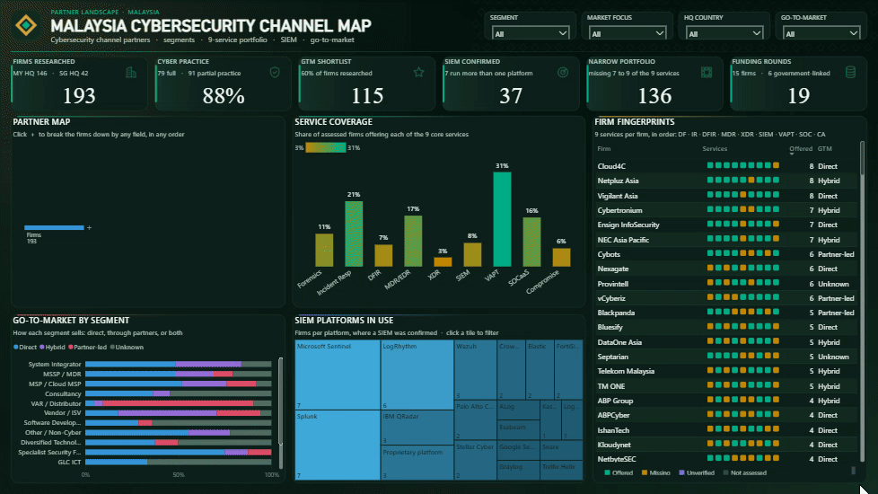

# Malaysia Cybersecurity Channel Map (Power BI)

A one-page Power BI dashboard of **193 IT and cybersecurity firms operating in Malaysia**, researched as potential
channel partners: segment, 9 managed-security services, SIEM platform, funding and go-to-market model. Every finding
carries a confidence rating and an evidence link.

## What's inside
- **Decomposition tree:** the viewer picks the breakdown (segment, go-to-market, SIEM, market focus and more).
- **Service fingerprint:** each firm's 9 services as 9 coloured squares (offered / missing / unverified), drawn by
  a DAX measure that returns an SVG image.
- **Service coverage** coloured by value.
- **SIEM platform treemap:** 37 firms with a confirmed platform, 19 platforms.
- **Go-to-market by segment** as 100% bars (Direct, Partner-led, Hybrid, Unknown).
- KPI tiles with subtitles that update with the filters, and slicers in the header. Click any visual to
  cross-filter the page; hover a firm to see its profile card.

## How it's built
- Three research tables (companies, SIEM platform links, funding rounds) joined on one Company ID. The research
  modules were matched on website domain, not name: 27 names differ in the funding workbook alone.
- Power Query unpivots the 9 service columns and the 5 confidence columns. Sort-by columns keep bands and
  confidence levels in a logical order.
- "Not verified" and "not assessed" firms are kept apart from a strong portfolio, so gaps are not overstated.
  Funding amounts stay as disclosed (MYR, USD, SGD, IDR) and are never converted.
- The 1920×1080 background artboard and theme are generated in Python.

## Open it
- Open `powerbi/MalaysiaCybersecurityChannelMap.pbip` in Power BI Desktop, set the **DataFolder** parameter, and
  Refresh.
- The research data is private and not included. The model expects `malaysia_companies.csv`,
  `malaysia_siem_platforms.csv` and `malaysia_funding_rounds.csv`.
- Only a "decision makers found" count is kept: no names, roles, emails or phone numbers.

**Tools:** Power BI (PBIP: TMDL + PBIR), Power Query (M), DAX, SVG, Python · built with Claude Code as a coding
assistant
